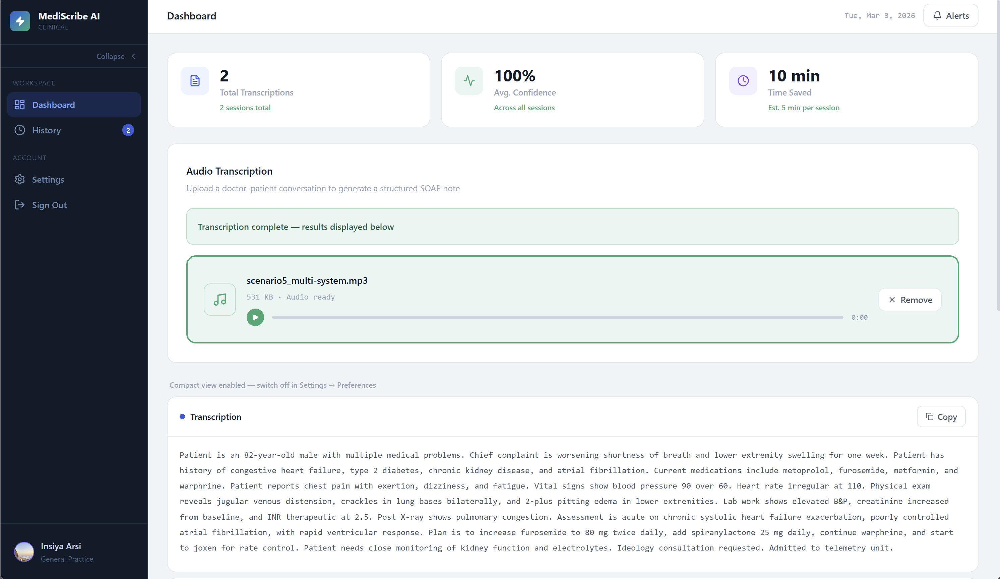
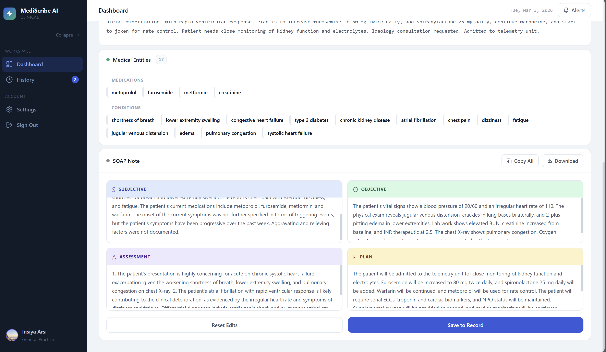

# MediScribe AI

A production-grade ambient clinical documentation system that converts doctor–patient audio conversations into structured, evidence-linked SOAP notes using on-premise speech recognition, biomedical NLP, and grounded LLM synthesis.




[](https://github.com/insiyaarsi/mediscribe-ai)
[](https://github.com/insiyaarsi/mediscribe-ai)
[](docs/testing.md)
[](LICENSE)

---

## Overview

MediScribe AI assists healthcare providers by capturing clinical encounters and producing documentation-grade SOAP notes with full auditability.

Key highlights of the system:
- **Local Audio Privacy**: Speech-to-text inference runs locally via `faster-whisper`. Sensitive patient voice recordings never leave the host server.
- **Biomedical Entity & Assertion Extraction**: Combines `scispaCy` (`en_ner_bc5cdr_md`) with `medspaCy` ConText to extract clinical concepts and detect assertions (negations, historical context, family relations, and uncertainty).
- **Grounded SOAP Synthesis**: Uses LLaMA 3.3 via the Groq API with structured JSON outputs. Enforces strict clinical non-fabrication rules (vital signs and undocumented exams are never synthesized). Includes a deterministic rule-based fallback if offline.
- **Statement-Level Evidence Linking**: Automatically matches each generated SOAP statement to verbatim supporting sentences in the transcript using `rapidfuzz`. Statements lacking verbatim backing are explicitly flagged for clinician review.
- **Full Draft-Review-Approval Lifecycle**: Guarantees human-in-the-loop oversight through a structured workflow: `Uploaded` → `Transcribing` → `Transcript Ready` → `Draft Generated` → `In Review` → `Approved`.
- **Modern React 19 Frontend**: Features line-by-line transcript editing, interactive evidence highlighting, dark mode, consultation history, and audio management.

---

## Documentation Suite

Comprehensive documentation is available in the [`docs/`](docs/) directory:

- [System Architecture](docs/system-architecture.md) — High-level architecture, component topology, and Mermaid diagram.
- [Component Responsibilities](docs/component-responsibilities.md) — In-depth breakdown of inputs, outputs, and interactions for all backend and frontend modules.
- [Technology Stack](docs/technology-stack.md) — Exhaustive list of technologies, exact versions, and design rationales.
- [Data Flow](docs/data-flow.md) — Sequence diagrams and flowcharts detailing the intake, review, and approval lifecycle.
- [Testing & Verification Guide](docs/testing.md) — Test suite breakdown, conftest mocking strategy, and verification commands (292 passed tests).
- [Privacy, Security & Limitations](docs/privacy-and-limitations.md) — Medical device disclaimer, audio retention rules, and acoustic boundaries.
- [Live Presentation Script](docs/presentation-script.md) — Timed 10-minute presentation and jury defense guide with Q&A prep.
- [Security & Privacy Audit](docs/SECURITY_AND_PRIVACY.md) — Security boundaries, token auth, and data protection specs.
- [Local Development Guide](docs/local-dev.md) — Developer environment setup and run scripts.

---

## Clinical Documentation Pipeline

```
Audio Recording / Upload (.wav, .mp3, .m4a, .webm)
    │
    ▼
Intake Validation ── Type whitelist, MIME inspection & 50MB size guard
    │
    ▼
Local Whisper STT ── faster-whisper CTranslate2 (base.en / configurable)
    │
    ▼
Content Validator ── Dual-criteria medical gate (density + markers)
    │                Rejects non-clinical audio before NLP
    ▼
Transcript Review ── Clinician line-by-line editing & correction
    │
    ▼
Biomedical NLP ───── scispaCy (en_ner_bc5cdr_md) + 843-term gazetteer
    │                medspaCy ConText: Negation, Temporality, Experiencer
    ▼
SOAP Note Gen ────── Groq LLaMA 3.3 (structured JSON) + Rule-based fallback
    │
    ▼
Evidence Linking ─── rapidfuzz string alignment; flags unsupported claims
    │
    ▼
Clinician Review ─── Side-by-side SOAP editing & interactive evidence inspection
    │
    ▼
Explicit Approval ── Permanent audit timestamp, Clinician ID, locked note
```

---

## Tech Stack Summary

| Layer | Technologies |
|---|---|
| **Frontend** | React 19.2, TypeScript ~5.8, Vite 7.3, Tailwind CSS v4, Zustand 5, Axios, Lucide React, Sonner |
| **Backend API** | FastAPI 0.104, Uvicorn 0.24, Pydantic v2, Python 3.10+ |
| **Speech-to-Text** | `faster-whisper` (CTranslate2, int8 local inference), FFmpeg |
| **Biomedical NLP** | `scispaCy` (`en_ner_bc5cdr_md`), `medspaCy`, `spaCy`, `rapidfuzz` |
| **LLM Inference** | Groq Python SDK (`llama-3.3-70b-versatile` / configurable via `GROQ_MODEL`) |
| **Persistence** | SQLite (development/tests), PostgreSQL (production) via SQLAlchemy 2.0 & Alembic |
| **Authentication** | JWT (HS256, `python-jose`), `passlib` with `bcrypt` password hashing |
| **Testing** | `pytest` ≥ 8.0, `httpx`, in-memory SQLite (292 passed, 10 skipped) |

---

## Quickstart & Local Setup

### Prerequisites
- Python 3.10+
- Node.js 18+ & npm
- FFmpeg installed and available on system PATH
- Groq Cloud API Key (Optional — fallback generator activates automatically if missing)

### 1. Backend Setup

```bash
# Navigate to backend directory
cd backend

# Create and activate a virtual environment
python -m venv venv
# On Windows:
.\venv\Scripts\activate
# On Linux/macOS:
source venv/bin/activate

# Install dependencies
pip install -r requirements.txt
python -m spacy download en_core_web_sm
pip install https://s3-us-west-2.amazonaws.com/ai2-s2-scispacy/releases/v0.5.4/en_ner_bc5cdr_md-0.5.4.tar.gz

# Configure environment variables
cp ../.env.example .env
# Edit .env to set your JWT_SECRET_KEY, GROQ_API_KEY, and DATABASE_URL

# Apply database migrations
alembic -c alembic.ini upgrade head

# Start FastAPI server
uvicorn main:app --reload --host 0.0.0.0 --port 8000
```
API runs at `http://localhost:8000` (Interactive Swagger docs: `http://localhost:8000/docs`).

### 2. Frontend Setup

```bash
# Navigate to frontend directory in a new terminal
cd frontend

# Install dependencies
npm install

# Start Vite development server
npm run dev
```
Frontend runs at `http://localhost:5173`.

---

## Running the Automated Test Suite

The test suite runs entirely with mocked neural models and an in-memory SQLite database:

```bash
cd backend
python -m pytest tests/ -q
```

**Verified Test Results**:
```
292 passed, 10 skipped in 20.05s
```

---

## API Endpoints

### Authentication
- `POST /api/auth/register` — Create new clinician account
- `POST /api/auth/login` — Authenticate and receive JWT access token
- `GET /api/auth/me` — Retrieve active user session and preferences
- `PUT /api/auth/me` — Update clinician profile and note style preferences
- `DELETE /api/auth/me` — Permanently delete user account and associated data

### Consultation Workflow (`/api/consultations/*`)
- `POST /api/consultations/upload` — Upload clinical audio file (.wav, .mp3, .m4a, .webm < 50MB)
- `POST /api/consultations/{id}/transcribe` — Execute local speech recognition
- `GET /api/consultations/{id}/transcript` — Retrieve transcript text and segments
- `PUT /api/consultations/{id}/transcript` — Save clinician edits to transcript
- `POST /api/consultations/{id}/extract` — Extract medical entities and assertions
- `POST /api/consultations/{id}/soap` — Generate draft SOAP note with Groq LLM
- `PUT /api/consultations/{id}/soap` — Save clinician edits to SOAP sections
- `GET /api/consultations/{id}/soap/evidence` — Retrieve statement-level transcript evidence links
- `POST /api/consultations/{id}/approve` — Record explicit clinician approval with timestamp
- `GET /api/consultations` — List user's consultation sessions
- `GET /api/consultations/{id}` — Retrieve full consultation details
- `DELETE /api/consultations/{id}` — Delete consultation and associated entities
- `DELETE /api/consultations/{id}/audio` — Purge raw audio file while keeping textual records

### Legacy Monolithic Pipeline & History
- `POST /api/transcribe` — Synchronous end-to-end transcription, extraction, and SOAP generation (audio auto-purged in finally block)
- `GET /api/history` — Chronological history query
- `GET /api/history/{id}` — Individual consultation session inspection
- `DELETE /api/history/{id}` — Delete session

---

## Privacy, Security & Disclaimers

> **CLINICAL NOTICE**: MediScribe AI is an assistive clinical documentation tool and is **not an FDA/EMA-cleared medical device**. It does not autonomously diagnose conditions, recommend treatments, or replace physician oversight. All generated text must be reviewed, edited, and approved by a licensed healthcare provider before entering legal Electronic Health Records.
> 
> Raw audio files can be deleted immediately post-approval. Third-party API keys are strictly confined to backend environment variables and are never transmitted to client browsers.

For additional privacy details, see [docs/privacy-and-limitations.md](docs/privacy-and-limitations.md).
