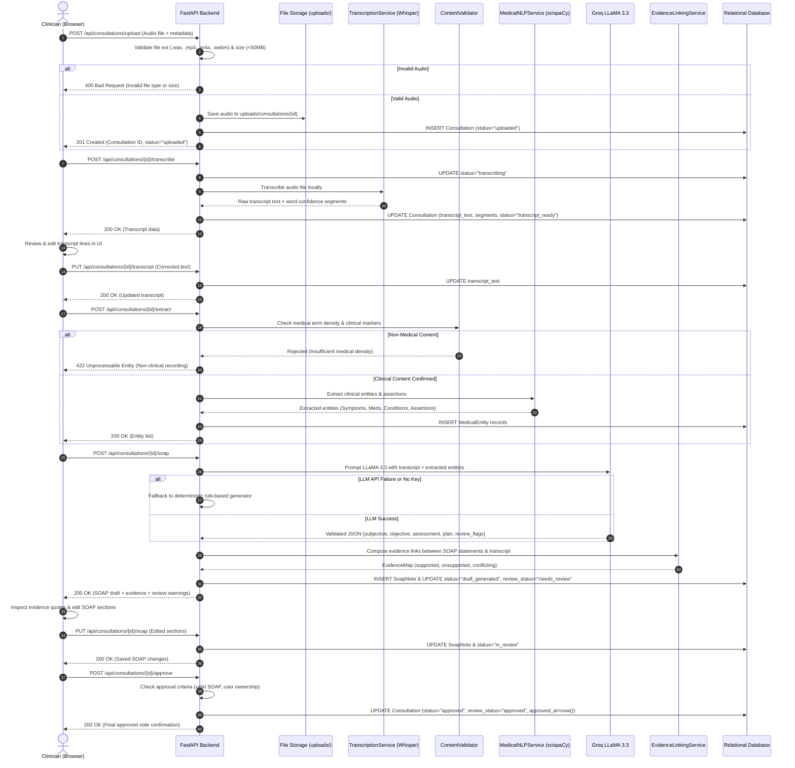
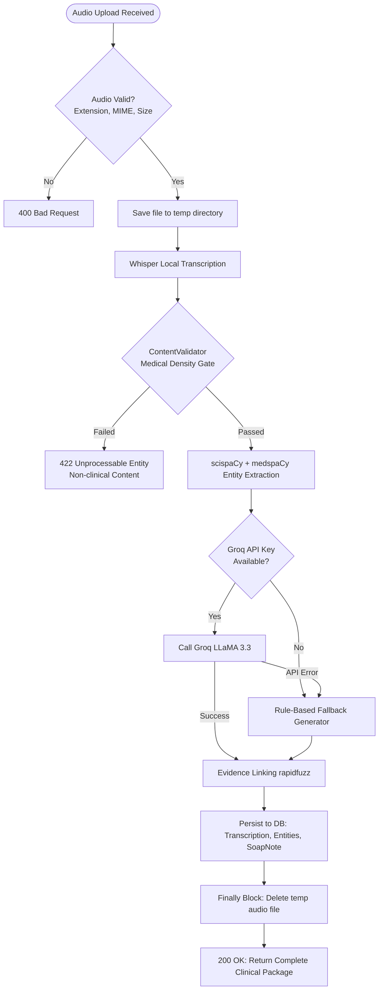

# MediScribe AI — Data Flow Architecture

This document details the complete end-to-end data lifecycle in MediScribe AI, covering audio intake, validation checks, automated intelligence generation, clinician review and edit phases, and permanent approval.

---

## 1. Multi-Step Consultation Workflow (Primary Path)

The primary consultation workflow allows discrete inspection and intervention at each stage of note generation.



---

## 2. Monolithic Legacy Pipeline (`POST /api/transcribe`)

For rapid synchronous drafting, the legacy route coordinates transcription, extraction, and SOAP generation in a single HTTP request:



---

## 3. Validation Gates & Error Handling

| Phase | Gate / Check | Failure Mode | Mitigation / Response |
|---|---|---|---|
| **Intake** | File extension whitelist (`.mp3`, `.wav`, `.m4a`, `.ogg`, `.webm`) | Invalid extension | Returns `400 Bad Request` with acceptable format list. |
| **Intake** | File size boundary (Max 50MB) | Payload exceeds 50MB | Returns `400 Bad Request` preventing server memory exhaustion. |
| **Intake** | MIME type inspection via file headers | Spoofed file extension | Rejects stream before disk persistence. |
| **Transcription** | CTranslate2 inference exception | Corrupt audio stream | Returns `500 Internal Server Error`, logs diagnostic trace. |
| **Content Gate** | `ContentValidator` medical density | Non-medical dialogue | Returns `422 Unprocessable Entity` ("Transcript does not meet clinical threshold"). |
| **NER / NLP** | Assertion parsing failure | Unparseable syntax | Defaults entity assertion to `PRESENT` and logs warning. |
| **SOAP Gen** | Missing `GROQ_API_KEY` | Environment unconfigured | Transparently activates `_generate_fallback_soap` without breaking pipeline. |
| **SOAP Gen** | Groq rate limit / timeout / connection | External network fault | Catches `GroqRateLimitError` / `GroqTimeoutError`, falls back to rule-based engine. |
| **Evidence** | Fuzzy matching threshold (<50%) | Unverifiable claim | Flags statement as `"Evidence not found — review required."` |
| **Approval** | Clinician authorization & note completeness | Missing required sections | Blocks transition to `approved`, keeps status in `in_review`. |

---

## 4. Clinician Review & Edit State Transitions

The consultation state machine enforces strict governance over document status:

```
[ Uploaded ]
     │
     ▼
[ Transcribing ]
     │
     ▼
[ Transcript Ready ]  <───────────┐ (Clinician edits transcript text)
     │                            │
     ▼                            │
[ Draft Generated ]               │
     │                            │
     ▼                            │
[ In Review ]  ───────────────────┘ (Clinician reviews evidence & modifies sections)
     │
     ▼ (Explicit Clinician Approval Action)
[ Approved ]  ──> Final locked clinical note (Audit timestamp & Clinician ID recorded)
```

1. **Explicit Sign-off**: A consultation note is never automatically set to `approved` by automated processes; it requires an intentional action from an authenticated clinician.
2. **Post-Approval Immutability**: Approved notes preserve historical audit trails and cannot be overwritten without generating a revision entry.
