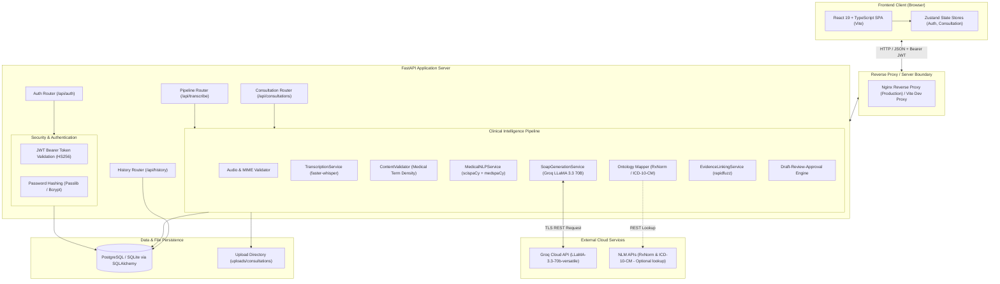

# MediScribe AI — System Architecture

This document describes the architectural layout, major system components, operational environments, and integration boundaries for MediScribe AI.

---

## 1. High-Level Architecture

MediScribe AI is structured as a decoupled client-server architecture composed of a React single-page application (SPA), an asynchronous FastAPI backend service, local biomedical Natural Language Processing (NLP) and Speech-to-Text (STT) models, external cloud LLM inference, and relational persistence.

---

## 2. Core Architectural Components

### 2.1 Frontend Client (Implemented)
- **Role**: Single-page application providing clinical navigation, real-time audio recording/upload, transcript review and line editing, interactive SOAP review with evidence citation inspection, clinician revision, and approval sign-off.
- **Technology**: React 19.2, TypeScript 5.8, Vite 7.3, Tailwind CSS v4, Lucide icons, Sonner toasts, Axios, Zustand state stores.
- **Routing**:
  - `/login` — Clinician authentication
  - `/dashboard` — Session overview, active draft counts, quick metrics
  - `/consultations/new` — Audio capture and intake upload
  - `/consultations/:id` — Consultation summary and progress tracker
  - `/consultations/:id/transcript` — Step-by-step transcript inspection and editor
  - `/consultations/:id/soap` — Sectioned SOAP review with interactive evidence highlight and warning flags
  - `/history` — Searchable chronological consultation repository
  - `/settings` — Clinician preferences, audio retention policies, theme settings

### 2.2 API Server & Gateway (Implemented)
- **Role**: RESTful interface providing request routing, authentication guards, multi-part audio streaming, pipeline orchestration, error boundary mapping, and state machine enforcement.
- **Technology**: FastAPI 0.104.1 running on Uvicorn, Python 3.10+.
- **Endpoints**:
  - `/api/auth/*` — User registration, login, profile, session validation
  - `/api/consultations/*` — Discrete workflow endpoints (upload, transcribe, edit transcript, extract entities, generate SOAP, fetch evidence, approve, delete)
  - `/api/transcribe` — Monolithic end-to-end processing pipeline for immediate synchronous drafting
  - `/api/history/*` — Historical session queries, individual retrieval, and deletion
  - `/health`, `/api/health` — Liveness and diagnostic checks

### 2.3 Audio & Speech-to-Text Engine (Implemented)
- **Role**: Validates audio container format, size limits, and channel profiles, followed by local, on-premise neural speech recognition.
- **Technology**: `faster-whisper` (CTranslate2 backend) using pre-trained Whisper weights (defaulting to `base.en`, configurable via `WHISPER_MODEL`).
- **Data Boundary**: Audio data processed on the local server without transmitting raw audio to third-party transcription vendors.

### 2.4 Biomedical NLP & Clinical Fact Extractor (Implemented)
- **Role**: Gatekeeping against non-clinical content, followed by entity extraction, assertion detection, and semantic categorization.
- **Sub-components**:
  - `ContentValidator`: Calculates medical token density and marker occurrence to reject non-clinical dictations prior to intensive parsing.
  - `MedicalNLPService` / `entity_extraction.py`: Employs `scispaCy` (`en_ner_bc5cdr_md`) for disease and chemical entity detection.
  - `medical_categories.py`: Classifies spans into `SYMPTOM`, `MEDICATION`, `CONDITION`, `PROCEDURE`, and `TEST` utilizing an 843-term curated clinical lexicon.
  - `clinical_assertions.py`: Leverages `medspaCy` ConText algorithm to determine negation ("denies fever"), uncertainty ("suspected pneumonia"), temporality ("past history"), and experiencer ("mother had stroke").

### 2.5 SOAP Generation & Evidence Linking Engine (Implemented)
- **Role**: Transforms grounded clinical entities and transcript facts into structured Subjective, Objective, Assessment, and Plan prose, with verifiable citations linked back to exact transcript spans.
- **Sub-components**:
  - `SoapGenerationService`: Communicates with Groq Cloud via official Groq Python SDK using structured system prompts, enforcing clinical accuracy and non-fabrication rules (e.g., vital signs are never synthesized). Includes deterministic rule-based fallback when LLM keys or network connectivity are absent.
  - `EvidenceLinkingService`: Executes fuzzy token-ratio analysis (`rapidfuzz`) between each generated SOAP statement and transcript sentences to produce evidence linkages (`supported`, `unsupported`, `conflicting`, `ambiguous`).

### 2.6 Persistence Layer (Implemented)
- **Role**: Stores relational records of users, audio metadata, transcript text and segments, extracted entities, generated SOAP notes, review flags, and audit timestamps.
- **Technology**: PostgreSQL (production) or SQLite (testing/local dev) managed via SQLAlchemy 2.0 ORM and Alembic schema migrations.

---

## 3. Implemented vs. Planned Components

| Component | Status | Implementation Details |
|---|---|---|
| **FastAPI REST API** | Implemented | Fully functional with JWT auth, router separation, error handling |
| **Local Whisper STT** | Implemented | Thread-safe singleton using `faster-whisper` (base.en / configurable) |
| **Medical Gatekeeper** | Implemented | Density and keyword validation rejecting non-clinical audio |
| **Biomedical NER** | Implemented | `scispaCy` BC5CDR model with assertion tagging via `medspaCy` |
| **Groq LLaMA 3.3 SOAP Gen** | Implemented | Groq SDK integration with fallback rule-based synthesis |
| **Evidence Linking Engine** | Implemented | Statement-level transcript alignment via `rapidfuzz` |
| **Draft-Review-Approval Flow** | Implemented | Stepwise lifecycle: Uploaded → Transcribing → Transcript Ready → Draft Generated → In Review → Approved |
| **User Data Isolation** | Implemented | Consultation ownership enforced at database query level |
| **Interactive Frontend** | Implemented | Full React 19 UI with transcript & SOAP editing, evidence highlight |
| **EHR / FHIR Export (HL7/FHIR)** | Planned | Direct bidirectional export to Epic/Cerner via HL7 FHIR v4 API |
| **Multi-Speaker Diarization** | Planned | Separation of doctor and patient dialogue channels (e.g., PyAnnote) |
| **Tamil-English Code Switching** | Planned | Specialized multi-lingual acoustic model fine-tuning |
| **Real-Time WebSocket Streaming** | Planned | Live partial transcript and entity extraction during consultation |

---

## 4. Security & Network Boundary Isolation

1. **API Keys Isolation**: The `GROQ_API_KEY` exists exclusively in the backend runtime environment. The frontend client has zero direct access to third-party LLM endpoints.
2. **Audio File Lifecycle**: 
   - Monolithic `/api/transcribe`: Audio written to temporary storage and deleted unconditionally in a `finally` block post-inference.
   - Stepwise `/api/consultations/upload`: Audio saved under `uploads/consultations/` with explicit API deletion routes (`DELETE /api/consultations/{id}/audio`).
3. **Database Security**: All user queries include tenant-specific constraints (`WHERE user_id = current_user.id`) to prevent cross-account information leakage.
